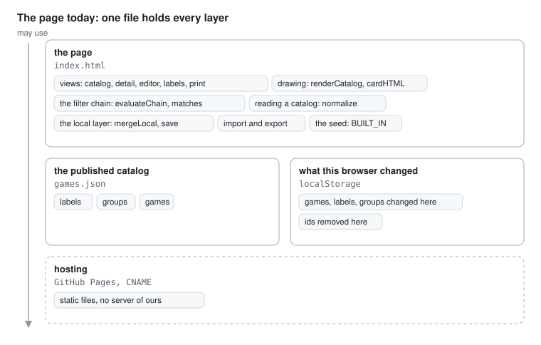
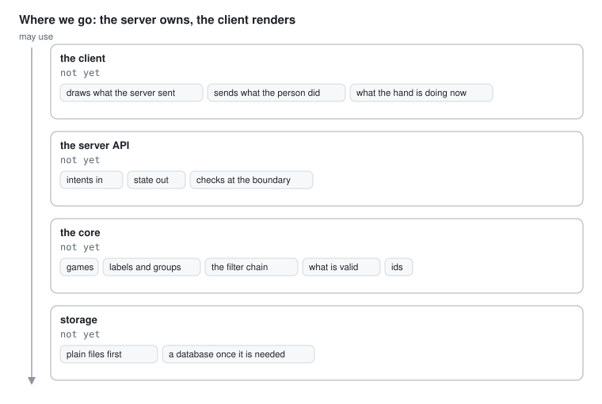

# Architecture

Where each kind of thing belongs in the games catalog, and what must stay
true. Read it before a change, and put the change where it says. How to
keep and change this file is the architecture skill in
`.claude/skills/architecture/`.

The catalog is two things at once today. It is what runs now, one page
with everything in it, and it is what we build toward, a server that owns
every rule and all the state and a client that only renders. Each section
says both. New code is written for the second.

## Bird's eye view

### Today: one page

The page is served as static files by GitHub Pages, at the domain in
`CNAME`. There is no build step and no server of our own. The page loads
`games.json`, lays what this browser changed on top of it from
`localStorage`, and draws the result. An export writes the merged
catalog as JSON, and committing that as `games.json` publishes it.

### Where we go: the server owns, the client renders

A part may use the parts under it and knows nothing of the parts over
it. Every rule lives in the core, where the API reaches it. The client
holds no rule and no state of its own beyond what the hand is doing
right now, see section 4 of the architecture skill.

The move from the first to the second is #4. It has its decision record in
`docs/decisions/`, with its five candidates, before its first code, see
Changing the architecture in the skill.

The drawings are plain SVG in `docs/diagrams/`, a box a `rect` with its
texts and a chip a small `rect` with its text, and they follow the
reader's light or dark theme, on a background of their own. A change
that moves a box changes its drawing in the same pull request.

## Code map

| Part | Code | Owns | Never holds |
| --- | --- | --- | --- |
| the page today | `index.html` | everything: the data model, the filter, the storage, the views, import and export | |
| the published catalog | `games.json` | the catalog everyone sees, in the data model's shape, with its `schemaVersion` | anything only one browser changed |
| repository files | `.github/` | the templates for pull requests and issues | anything about games |
| client, planned | not yet | drawing, and passing on what the person did | a rule, or state of its own |
| server, planned | not yet | the API and the core | anything about a screen or a click |

## Where state lives

Every piece of state has one home and one writer. Today the page breaks
that in two places, the built-in seed and the local layer, both under
Not to copy.

| State | Home today | Writer today | Home once the server is built |
| --- | --- | --- | --- |
| the published catalog | `games.json` | an export, committed by hand | the server's storage, written by the core |
| a second copy of the published catalog, for when `games.json` cannot be fetched | `BUILT_IN` in `index.html`, kept identical to `games.json` by hand, with nothing that checks it | whoever edits `games.json` | gone |
| the catalog as this page loaded it | `base` in `index.html` | `loadBase()` | gone |
| what this browser changed | `localStorage`, under the key in `KEY`, as the difference from `base` | `save()` | gone. Every change goes to the server |
| the catalog this page shows, `base` with the local changes on top | `db` in `index.html` | `mergeLocal()` at start, and an import | what the server last sent |
| the filter chain and the search | `chain`, `query` and `labelQuery` in `index.html` | the filter's and the search's handlers | what the client sends with each request. The server works out the matches |
| which page shows, and where Back goes | `here` and `trail` in `index.html`, the page's own back stack, not the browser's history | `go()` and `back()` | the client, as what the hand is doing |
| what is being typed in the editor | `draft` in `index.html` | the editor's fields | the client, until it is saved to the server |

## Where does it go?

| I need to | It goes |
| --- | --- |
| add or change a rule about games, labels or groups | today in `index.html`, beside the rule of its kind, and named under Not to copy if it is new. Until the server's decision record is merged, a feature built this way counts as the same, not worse, in a review, because there is nowhere else for it to go yet. Once the server is built, the core, never the client |
| decide which games match a filter | today `evaluateChain` and `matches` in `index.html`. Once the server is built, the core |
| decide which games are related | today `relatedGames` in `index.html`, from the groups whose `relates` is on. Once the server is built, the core |
| check that a game or an import is valid | today `normalize` in `index.html`, the one reader of a catalog from outside. Once the server is built, the server, at its boundary |
| show a new fact about a game | today the template that draws it in `index.html`. Once the server is built, a field the API sends, drawn by the client |
| store something | today the catalog's shape, through `save()` and an export. Once the server is built, the server's storage. Never a second key in `localStorage` |
| change the shape of the catalog | raise `SCHEMA` in `index.html` and `schemaVersion` in `games.json` together, and keep reading the shape before it |
| show text from the catalog | through `esc`, never into HTML by hand |
| ask before something that cannot be undone | `ask` in `index.html`, the one dialog. Never `window.confirm`, which a sandboxed page blocks |

## Invariants

1. One reader for a catalog from outside. `games.json` and an import both
   go through `normalize`. Held by the review.
2. Text from the catalog is escaped where it is shown, by `esc`. Held by
   the review.
3. One shape of the catalog, the same for `games.json`, an export and the
   built-in seed, described at the top of the script in `index.html`.
   Held by the review.
4. `BUILT_IN` in `index.html` is the same catalog as `games.json`. Held
   by nothing yet, #5.
5. Once the server is built: every rule is in the core, and the client
   holds none. Held by the review, and by the API, which sends state and
   takes intents.

## Boundaries

- `games.json` and its `schemaVersion`, which every browser that has the
  page reads, an older page and a newer catalog included.
- The `localStorage` key and the shape stored under it, which a browser
  keeps from one version of the page to the next.
- Once it is built, the API between the client and the server.

## Not to copy

The page holds rules and state that belong to the server once there is
one. They are the state to move away from, not the pattern for new
code.

- The rules in `index.html`: the filter chain, `evaluateChain`,
  `matches` and `matchesQuery`, which games are related in
  `relatedGames`, the checks in `normalize`, what a label
  is used by in `labelUsage`, how ids are made in `slug` and `uniqueId`,
  #4.
- The state in the browser: the local layer in `localStorage` and its
  merge onto the published catalog, `mergeLocal` and `localChanges`, #4.
- A catalog published by committing an export by hand, #4.
- `BUILT_IN` in `index.html`, a second copy of `games.json` that nothing
  holds to it, #5.
